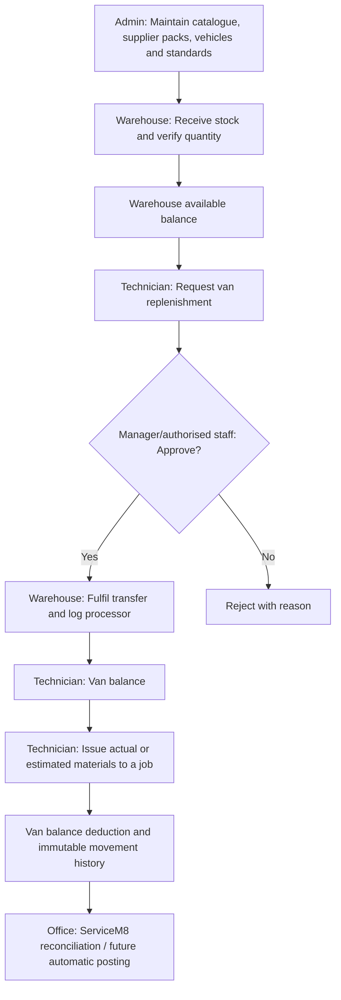
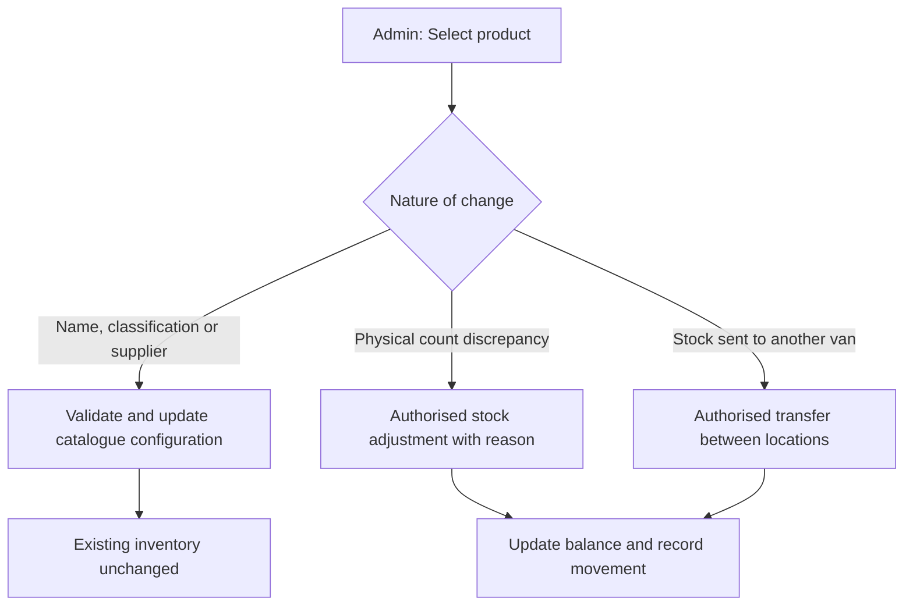

# Administration and operating workflows — development baseline

Status: draft for implementation and testing; this is not a production release instruction.

## Source of truth

Simplicity Air SOP Rev 6 remains the operational reference. Later project decisions supersede
its spreadsheet/PIN architecture and its older treatment of bulk consumables and cylinders.
The current application uses Next.js, Supabase authentication and a transaction ledger.

## Catalogue and threshold semantics

- `products.min_stock` is a **fallback van minimum**, used only if that van/product
  has no explicit entry in `van_stock_standards`. It is not a warehouse reorder level.
- Each van/product standard has its own minimum and target quantity.
- Warehouse minimum/target must be held in a separate warehouse-specific configuration;
  it must not silently inherit the product fallback van minimum.
- Physical inventory changes only through receiving, transfers, issues, and audited
  adjustments. Editing catalogue, classification, supplier, bin, or vehicle details does
  not create or alter balances.

## Planned CSV/ServiceM8 import contract

The previous CSV import was limited to product definitions:
`name,category,stock_unit,min_stock`. The draft expanded importer now accepts optional,
reviewed metadata: tracking classification, ServiceM8 item number and material UUID,
supplier name and supplier part number. Do not infer a verified link
from the existence of an item number alone. If ServiceM8 mappings are unverified,
mark them `needs_review`, never `linked`.

The extended import validates the **whole file before writing** and uses one database
transaction for products, classifications and supplier hints. Supplier names are held as
unverified import hints until matched to an existing supplier or explicitly added;
do not create a supplier package merely from a name. Inventory remains zero
until a separate verified opening stocktake or receipt. Do not create purchase packages
without an explicit quantity and unit conversion.

## Vehicle register

Admin-managed registration: van number, rego, make, model, colour, fuel type, active.
Unique van identifiers and registrations should be company-scoped. Existing stock,
default assignments, authorised van references and history must survive edits.
Use archive/deactivate instead of physical delete. A van with stock cannot be retired
until stock is transferred or adjusted through audited movements. Inactive vans are
hidden from **new** assignments and transactions while remaining readable in history.

## Roles and material movements

Editing metadata is not a stock transaction:

## Release gates

1. Explicit database migration review, including RLS, indices, history and reversal.
2. Test CSV duplicates, unknown suppliers, partial failure, unit precision and mapping.
3. Test vehicle permissions, uniqueness, deactivation with stock/users, and history.
4. Test a complete receive → request → approve → fulfil → issue sequence against a
   disposable authenticated environment. Isolated PostgreSQL tests alone are insufficient.
5. Confirm existing production data, create a restorable backup, apply staged migrations,
   then deploy only after Garry's review and approval.

Outstanding SOP capabilities (separate delivery tracks): purchase/reorder log,
monthly stocktake/reconciliation, ServiceM8 exception review and automated billing.
